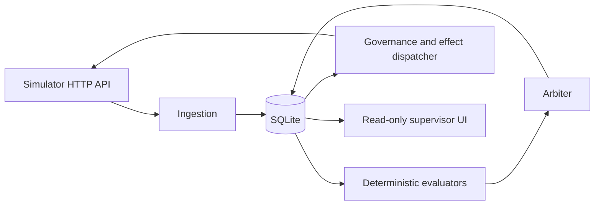
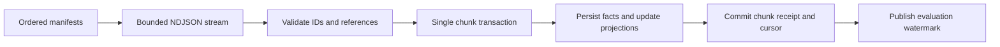
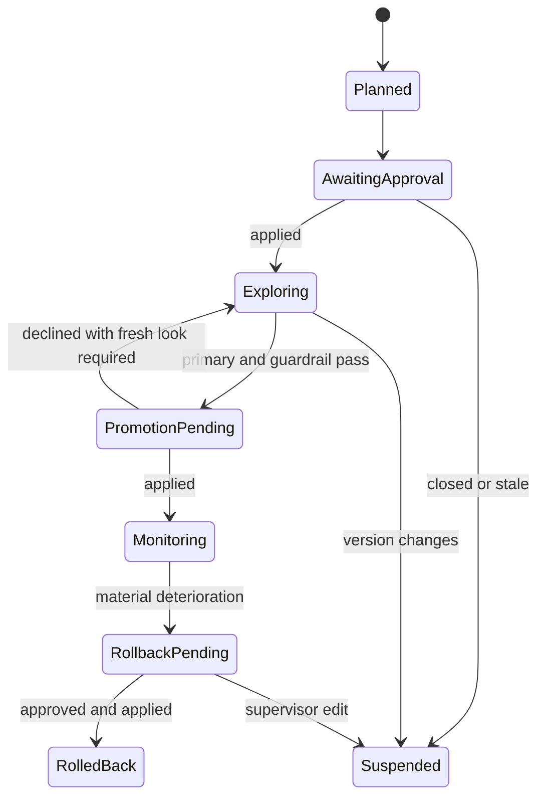
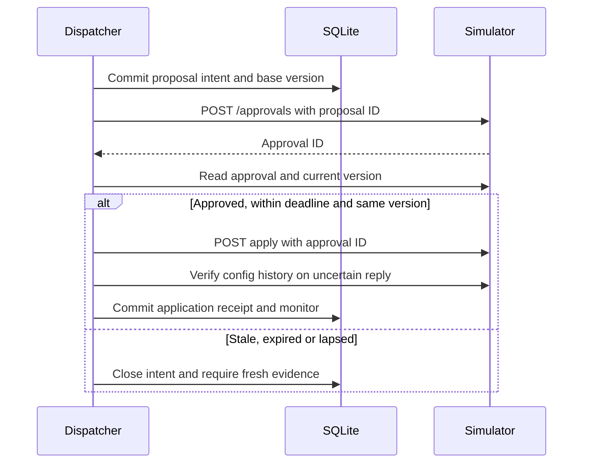
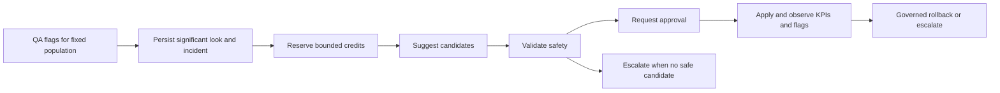
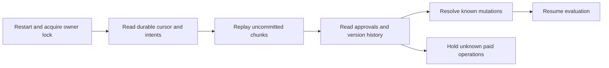
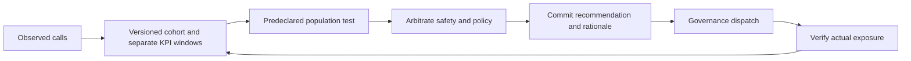

# Proposed architecture

One process runs bounded ingestion, pure evaluators, arbitration and an effect dispatcher. SQLite is the durable boundary. The read-only UI is a separate local process. The simulator owns assignments, time, policy and approvals.

The [entity diagram](DATA_MODEL.md) completes the eight views.
