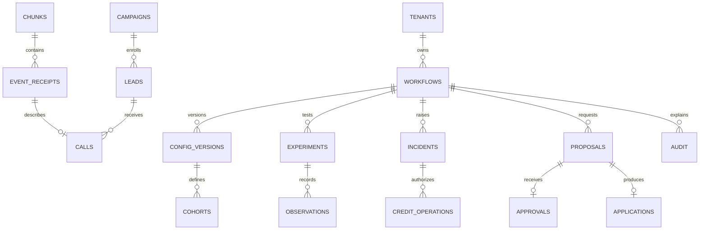

# Target persistence model

SQLite per evaluation world, WAL and FULL sync. Enable foreign keys on every connection. External identifiers are scoped to a run unless explicitly tenant-global. Use integer UTC timestamps plus policy timezone. JSON is acceptable for original config, policy and evidence snapshots. Keep lifecycle status, ownership and indexes relational.

| Table | Primary and foreign keys, constraints and indexes |
|---|---|
| tenants, workflows | tenant PK. workflow PK (run, workflow), tenant FK. Index tenant and active state. |
| config_versions | PK (run, workflow, version), workflow FK, config digest, actor, applied time, proposal reference. Index workflow and applied time. |
| checkpoints, chunks | PK (run, stream) and (run, chunk). Store last committed ID, manifest range, count and checksum. |
| event_receipts | PK (run, event_id), chunk FK, event time, type and workflow. Index workflow and event time. |
| campaigns, leads | PK (run, campaign) and (run, lead), campaign FK and version at creation. Index workflow/person and active campaign. Versioned feature fields or JSON. |
| cohorts | PK (run, workflow, config_version, cohort_id), config version FK, unique ordinal per version. Explicit fallback row. |
| calls | Event receipt PK and FK, lead FK, actual attribution and metric flags. Index workflow/version/time/event ID and lead. |
| kpi_windows | PK (run, workflow, version, cohort, bucket, metric, dimension, arm). Check 0 ≤ successes ≤ eligible. |
| experiments, arms | Experiment PK and workflow/config FK. Unique active epoch per workflow. Arm PK (experiment, cohort, arm). Persist assignment probabilities and designated control. |
| observations, looks | Observation PK (experiment, metric, person) with call FK; index (experiment, metric, cohort, arm, event_id). Look unique by experiment, metric, cohort, arm pair, window, sample size and test version. Persist counts and spending. |
| incidents | Incident PK and workflow FK. Unique active incident per workflow, kind and scope. Evidence look FK, state and version. |
| proposals, approvals | Proposal PK, unique idempotency key, base config FK. Approval PK and unique proposal FK. Index workflow/status and apply deadline. |
| applications | Application PK, unique proposal FK and resulting config FK. Rollback references original application. |
| credit_operations | Operation key PK, incident FK, estimated cost, state and receipt. Index tenant/status and reservation expiry. |
| audit | Append-only audit PK with run, workflow, timestamp, source cursor and typed subject ID. Index workflow/time and subject ID. |

Insert receipts, update facts and rollups, then commit chunk and cursor together. Look, recommendation and audit also commit together. Commit effect intent before HTTP and commit the observed result afterward. Link observations to the actual exposure version. Verify historical config references with the API before marking audit complete. If a historical FK target is unavailable, represent an explicit unresolved version receipt and block learning that requires it.

Keep all evidence for evaluation. Proposed production defaults are 30 days hot calls, 90 days hot rollups, and 12 months of minimized audit and receipts, subject to client retention agreements. Archive and verify replay before dropping partitions. Tokenize person IDs, separate customer identity, limit audit access and encrypt storage/backups.

For PostgreSQL, export snapshot at cursor, load typed facts, replay subsequent chunks, compare counts and sampled evidence, then fence the old writer before switching. Partition high-volume facts by time and route ownership by workflow. Ensure uniqueness across partitions through receipt identity or a separate dedup ledger.
